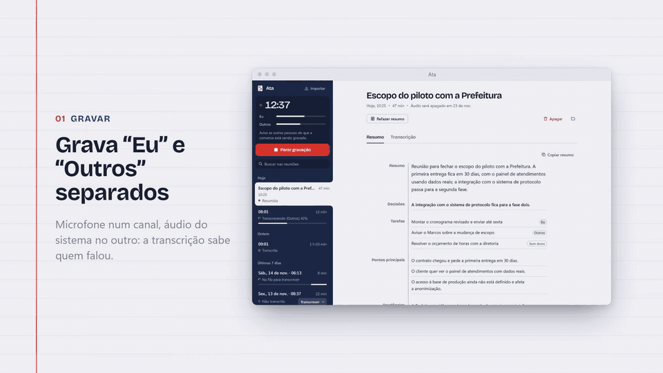
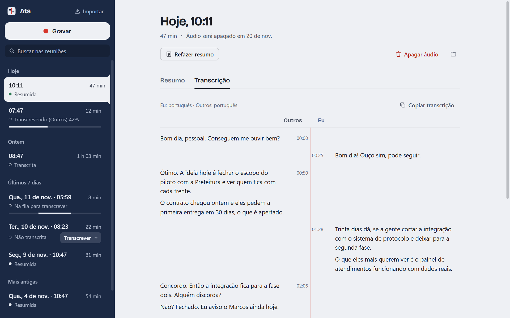
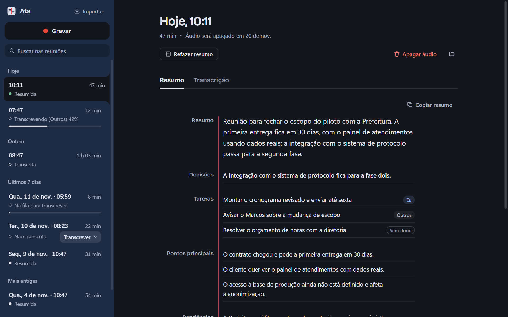
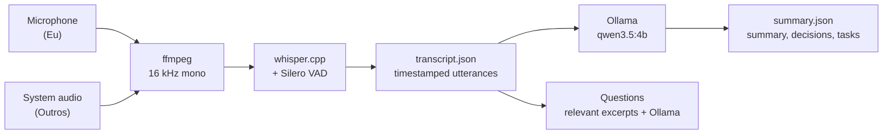

# Ata

[](https://github.com/vitorazevedop7/ata/actions/workflows/ci.yml)
[](https://github.com/vitorazevedop7/ata/releases/latest)
[](LICENSE)


[Português](README.md) · **English**

A desktop app that records meetings and calls on your computer, transcribes them, and writes
meeting minutes with a summary, decisions, and action items. **Everything runs on your
machine:** the audio, the transcript, and the summary never leave the computer, and there is
no paid API and no account to create. The app's interface is in Brazilian Portuguese.



[Full video (MP4)](docs/media/ata-demo.mp4) ·
[Download for Windows](https://github.com/vitorazevedop7/ata/releases/latest) ·
[Design decisions](docs/mvp.md) (in Portuguese) · [Benchmark](docs/benchmark.md) (in Portuguese)

## Why this project

Tools that take meeting notes for you are useful, but they send the audio of work
conversations to third-party servers and charge a subscription. I wanted the same result
under three constraints:

- **Privacy:** nothing leaves the computer. No network calls other than to `127.0.0.1`.
- **Zero cost:** no paid API, server, or account.
- **Ordinary hardware:** run on a 16 GB laptop with an entry-level GPU (MX450, 2 GB).

Ata is the result: a complete product, from the first benchmark to the installer, built as a
portfolio piece to show how I work end to end: measure before deciding, document the choices,
test the logic, and care about the experience of the people using it.

## What it does

- **Records the microphone and the system audio on separate channels.** What comes out of the
  speakers is "Outros" (others), what goes into the microphone is "Eu" (me). That way the
  transcript knows who spoke without needing diarization.
- **Imports audio or video files** (mp3, m4a, wav, mp4, WhatsApp audio), with the button or by
  dragging them into the window.
- **Transcribes locally** with [whisper.cpp](https://github.com/ggml-org/whisper.cpp)
  (`large-v3-turbo` model), on an NVIDIA GPU when there is one and on the CPU when there isn't.
- **Summarizes with a local model** on [Ollama](https://ollama.com) (`qwen3.5:4b`): overview,
  decisions, action items with owners, key points, and open items.
- **Answers questions about a meeting** ("what was agreed about the deadline?"), citing the
  transcript timestamps; clicking a timestamp jumps to that part of the conversation.
- **Gives each meeting a title**, suggested along with the summary and editable with one click.
- **Searches across all meetings** by title, summary, and transcript, ignoring accents and
  letter case.
- **Deletes the audio on its own after 7 days.** The transcript and the summary stay; the
  audio, which is the most sensitive and the heaviest data, does not. Audio that hasn't been
  transcribed yet is never deleted.
- Everything goes into a **background queue**, with progress visible in the list.

| Transcript                                                                                 | Dark theme                                                  |
| ------------------------------------------------------------------------------------------ | ----------------------------------------------------------- |
|  |  |

## How it works



- **Electron + React + TypeScript.** Windows loopback capture comes from Chromium itself
  (`getDisplayMedia` with `audio: 'loopback'`), with no native code.
- **A single job queue** in the main process ([`jobs.ts`](src/main/jobs.ts)): Whisper and
  Ollama run one after the other to fit in 16 GB of RAM. The queue resumes whatever was
  pending on its own if the app closes midway.
- **Storage in JSON files**, one folder per recording, with atomic writes so nothing gets
  corrupted in a power failure.
- **Validated structured output:** the model answers in schema-constrained JSON; long
  conversations are summarized in chunks of up to ~24,000 characters and then merged.

## Technical highlights

The most interesting problems that came up along the way, and how they were solved:

| Problem                                                                          | Solution                                                                                                                                                 |
| -------------------------------------------------------------------------------- | -------------------------------------------------------------------------------------------------------------------------------------------------------- |
| Knowing who spoke without diarization (slow and imprecise with local models)     | Record microphone and system audio on separate channels, transcribe each one, and interleave the utterances by timestamp                                 |
| Whisper's beam search took ~2h40 for a 1-hour meeting                            | Greedy decoding (`-bs 1 -bo 1`): **15× faster**, with no visible quality loss ([benchmark](docs/benchmark.md))                                           |
| Whisper invented repeated phrases in silences ("E aí" 81 times)                  | Silero voice activity detector (`--vad`): transcribes only the parts with speech                                                                         |
| English audio turned into nonsense with the language fixed to Portuguese         | Automatic language detection (`-l auto`)                                                                                                                 |
| A 1-hour transcript doesn't fit in the small model's context to answer questions | Relevance-based excerpt retrieval (TF-IDF-style scoring with simple stemming) plus spread-out excerpts for vague questions ([`ask.ts`](src/main/ask.ts)) |
| Right after Whisper released the GPU, Ollama sometimes failed to start CUDA      | Detect the error before the first token, restart the Ollama server, and retry once                                                                       |
| App closed in the middle of a recording or transcription                         | Audio recorded in chunks straight to disk, interrupted recording closed on startup, and queue resumed on its own                                         |

## Performance

Measured on a laptop with an i7-11390H, 16 GB of RAM, and a 2 GB NVIDIA MX450 GPU
(details in [docs/benchmark.md](docs/benchmark.md) (in Portuguese)):

| Step                          | 1-hour meeting |
| ----------------------------- | -------------- |
| Transcription on GPU (greedy) | ~10 min        |
| Transcription on CPU only     | ~1 h 40        |
| Summary with `qwen3.5:4b`     | ~9 min         |

## Installation

| System           | Record meetings | Import, transcribe, summarize, and ask |
| ---------------- | --------------- | -------------------------------------- |
| Windows 10 or 11 | Yes             | Yes (NVIDIA GPU optional)              |
| macOS            | Not yet         | Yes (Apple Silicon GPU via Metal)      |

### Windows: installer

1. Download `ata-<version>-setup.exe` from the [releases page](https://github.com/vitorazevedop7/ata/releases/latest).
   It installs for your user only, without asking for administrator rights. Because the
   installer is not signed, Windows may show a warning: click "More info" and "Run anyway".
2. Install the tools and models (about 8 GB) with the script below, which requires
   [Node.js](https://nodejs.org) 22 or newer.

### From source (Windows and macOS)

Requirements: [Node.js](https://nodejs.org) 22 or newer and about 8 GB of free space. On
macOS, also [Homebrew](https://brew.sh).

```bash
git clone https://github.com/vitorazevedop7/ata.git
```

```bash
cd ata
```

```bash
npm install
```

```bash
npm run setup:tools
```

```bash
npm run dev
```

`setup:tools` installs ffmpeg, whisper.cpp, and Ollama and downloads the models:

- **Windows:** tools in `%LOCALAPPDATA%\Programs` (whisper.cpp for CPU and, if there is an
  NVIDIA GPU, for CUDA) and models in `%LOCALAPPDATA%\ata\models`.
- **macOS:** ffmpeg and whisper.cpp through Homebrew, the official Ollama build
  (`ollama-binary`), and the models in `~/Library/Application Support/ata/models`.

If you already have any of these tools, point the app at it with the variables
`ATA_FFMPEG`, `ATA_WHISPER_CLI`, `ATA_MODELS_DIR`, `ATA_OLLAMA`, and `ATA_OLLAMA_MODEL`.

## Development

| Command                 | What it does                                         |
| ----------------------- | ---------------------------------------------------- |
| `npm run dev`           | Opens the app with hot reload                        |
| `npm test`              | Unit tests (Vitest)                                  |
| `npm run test:coverage` | Tests with a coverage report                         |
| `npm run typecheck`     | Type checking for the main process and the interface |
| `npm run lint`          | ESLint + Prettier                                    |
| `npm run build:win`     | Windows installer                                    |

```
src/main       main process: capture, queue, transcription, summary, questions, search, retention
src/preload    window.api bridge between the interface and the main process
src/renderer   React interface
src/shared     types used by all three
bench          scripts used to measure Whisper and Ollama
```

**Quality:** CI runs lint, tests, and build on Windows and macOS for every PR, and on macOS it
also installs the real tools, transcribes a sample audio with the same options the app uses,
and checks that the summary model answers in JSON. A `v*` tag builds the installer and
publishes the release. See [CONTRIBUTING.md](CONTRIBUTING.md) (in Portuguese) for the project
conventions and [docs/design.md](docs/design.md) (in Portuguese) for the visual identity.

## Privacy and consent

Ata sends nothing to the internet: transcription and summarization run in local processes
(whisper.cpp and Ollama on `127.0.0.1`). Even so, recording a conversation is your
responsibility: **tell the participants before you record**, as Brazil's data protection law
(LGPD) requires.

## Known limitations

- Recording only works on Windows. The system audio comes from the loopback that Electron
  offers only there; on macOS, the path is a small native module using Core Audio Taps
  (macOS 14.2 or newer). On macOS, for now, use Import.
- macOS support is verified in CI (build, tools, and models), but it hasn't been used on a
  real Mac yet.
- Without headphones, the microphone also picks up the other people's voices coming out of the
  speakers, and they show up on both channels.
- It doesn't separate more than two speakers: "Outros" is everyone on the other side of the
  call.
- It doesn't transcribe live; processing starts when the recording ends.

## Next steps

- Recording on macOS with Core Audio Taps.
- Questions across several meetings at once.
- Separating speakers within the "Outros" channel.

## Author

Made by **Vitor Augusto Viana Azevedo** ([@vitorazevedop7](https://github.com/vitorazevedop7)).

## License

[MIT](LICENSE)
