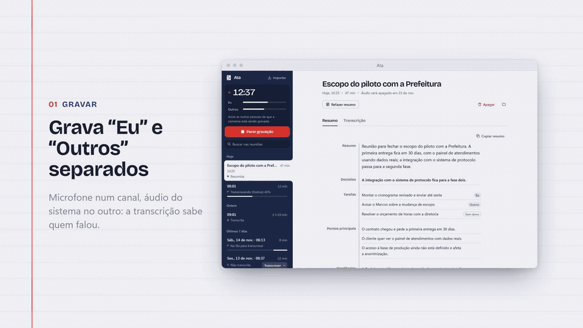
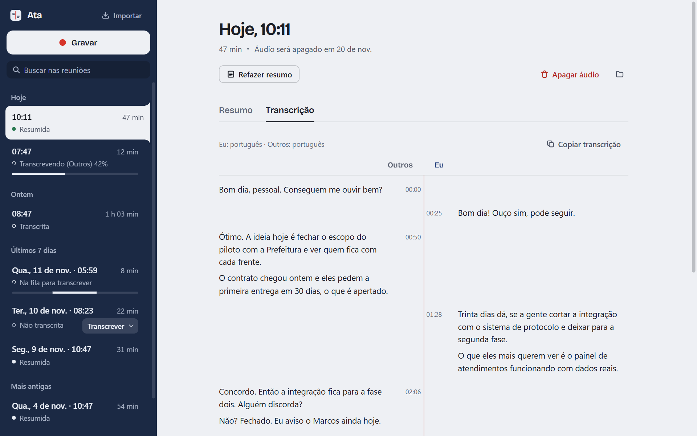
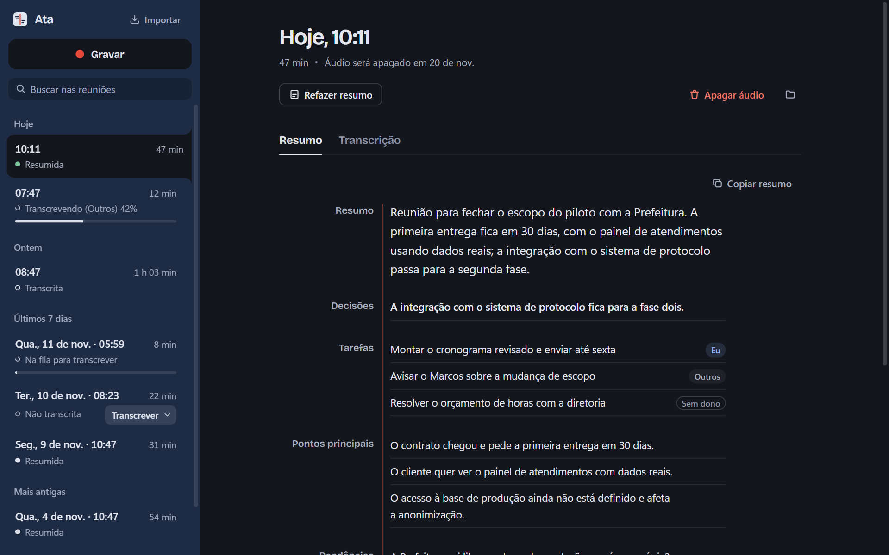
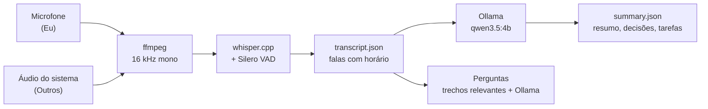

# Ata

[](https://github.com/vitorazevedop7/ata/actions/workflows/ci.yml)
[](https://github.com/vitorazevedop7/ata/releases/latest)
[](LICENSE)


**Português** · [English](README.en.md)

App desktop que grava reuniões e ligações no computador, transcreve e gera uma ata com
resumo, decisões e tarefas. **Tudo roda na sua máquina:** o áudio, a transcrição e o resumo
nunca saem do computador, e não há API paga nem conta para criar.



[Vídeo completo (MP4)](docs/media/ata-demo.mp4) ·
[Baixar para Windows](https://github.com/vitorazevedop7/ata/releases/latest) ·
[Decisões de projeto](docs/mvp.md) · [Benchmark](docs/benchmark.md)

## Por que este projeto

Ferramentas que anotam reuniões sozinhas são úteis, mas mandam o áudio de conversas de
trabalho para servidores de terceiros e cobram assinatura. Eu queria o mesmo resultado com
três restrições:

- **Privacidade:** nada sai do computador. Nenhuma chamada de rede além de `127.0.0.1`.
- **Custo zero:** nenhuma API paga, servidor ou conta.
- **Hardware comum:** rodar num notebook de 16 GB de RAM com uma GPU de entrada (MX450, 2 GB).

O Ata é o resultado: um produto completo, do primeiro benchmark ao instalador, construído
como portfólio para mostrar como eu trabalho de ponta a ponta: medir antes de decidir,
documentar as escolhas, testar a lógica e cuidar da experiência de quem usa.

## O que ele faz

- **Grava o microfone e o áudio do sistema em canais separados.** O que sai das caixas de
  som é "Outros", o que entra no microfone é "Eu". Assim a transcrição sabe quem falou sem
  precisar de diarização.
- **Importa arquivos** de áudio ou vídeo (mp3, m4a, wav, mp4, áudio do WhatsApp), pelo botão
  ou arrastando para a janela.
- **Transcreve localmente** com [whisper.cpp](https://github.com/ggml-org/whisper.cpp)
  (modelo `large-v3-turbo`), na GPU NVIDIA quando houver e na CPU quando não.
- **Resume com um modelo local** no [Ollama](https://ollama.com) (`qwen3.5:4b`): visão geral,
  decisões, tarefas com responsável, pontos principais e pendências.
- **Responde perguntas sobre uma reunião** ("o que ficou combinado sobre o prazo?"), citando
  os horários da transcrição; clicar no horário leva à fala.
- **Dá um título a cada reunião**, sugerido junto com o resumo e editável com um clique.
- **Busca em todas as reuniões**, pelos títulos, resumos e transcrições, sem diferenciar
  acentos nem maiúsculas.
- **Apaga o áudio sozinho depois de 7 dias.** A transcrição e o resumo ficam; o áudio, que é o
  dado mais sensível e mais pesado, não. Áudio que ainda não foi transcrito nunca é apagado.
- Tudo entra numa **fila em segundo plano**, com o progresso visível na lista.

| Transcrição                                                                          | Tema escuro                                             |
| ------------------------------------------------------------------------------------ | ------------------------------------------------------- |
|  |  |

## Como funciona



- **Electron + React + TypeScript.** O loopback do Windows vem do próprio Chromium
  (`getDisplayMedia` com `audio: 'loopback'`), sem código nativo.
- **Uma fila única de tarefas** no processo principal ([`jobs.ts`](src/main/jobs.ts)): Whisper e
  Ollama rodam um depois do outro para caber em 16 GB de RAM. A fila retoma sozinha o que
  ficou pendente se o app fechar no meio.
- **Armazenamento em arquivos JSON**, uma pasta por gravação, com escrita atômica para não
  corromper nada numa queda de energia.
- **Saída estruturada validada:** o modelo responde em JSON com esquema; conversas longas são
  resumidas em partes de até ~24 mil caracteres e depois juntadas.

## Destaques técnicos

Os problemas mais interessantes que apareceram no caminho, e como foram resolvidos:

| Problema                                                                             | Solução                                                                                                                                                        |
| ------------------------------------------------------------------------------------ | -------------------------------------------------------------------------------------------------------------------------------------------------------------- |
| Saber quem falou sem diarização (lenta e imprecisa em modelos locais)                | Gravar microfone e sistema em canais separados, transcrever cada um e intercalar as falas pelo horário                                                         |
| Beam search do Whisper levava ~2h40 para 1 h de reunião                              | Decodificação gulosa (`-bs 1 -bo 1`): **15× mais rápida**, sem perda visível de qualidade ([benchmark](docs/benchmark.md))                                     |
| Whisper inventava frases repetidas nos silêncios ("E aí" 81 vezes)                   | Detector de voz Silero (`--vad`): transcreve só trechos com fala                                                                                               |
| Áudio em inglês virava texto sem sentido com o idioma fixo em português              | Detecção automática de idioma (`-l auto`)                                                                                                                      |
| A transcrição de 1 h não cabe no contexto do modelo pequeno para responder perguntas | Recuperação de trechos por relevância (pontuação estilo TF-IDF com radical simples) mais trechos espalhados para perguntas vagas ([`ask.ts`](src/main/ask.ts)) |
| Logo depois do Whisper liberar a GPU, o Ollama às vezes falhava ao iniciar o CUDA    | Detectar o erro antes do primeiro token, reiniciar o servidor do Ollama e tentar de novo uma vez                                                               |
| App fechado no meio de uma gravação ou transcrição                                   | Áudio gravado em pedaços direto no disco, gravação interrompida fechada na abertura e fila retomada sozinha                                                    |

## Desempenho

Medido num notebook com i7-11390H, 16 GB de RAM e GPU NVIDIA MX450 de 2 GB
(detalhes em [docs/benchmark.md](docs/benchmark.md)):

| Etapa                            | 1 h de reunião |
| -------------------------------- | -------------- |
| Transcrição na GPU (modo guloso) | ~10 min        |
| Transcrição só na CPU            | ~1 h 40        |
| Resumo com `qwen3.5:4b`          | ~9 min         |

## Instalação

| Sistema          | Gravar reuniões | Importar, transcrever, resumir e perguntar |
| ---------------- | --------------- | ------------------------------------------ |
| Windows 10 ou 11 | Sim             | Sim (GPU NVIDIA opcional)                  |
| macOS            | Ainda não       | Sim (GPU do Apple Silicon via Metal)       |

### Windows: instalador

1. Baixe o `ata-<versão>-setup.exe` na [página de releases](https://github.com/vitorazevedop7/ata/releases/latest).
   Ele instala só para o seu usuário, sem pedir administrador. Como o instalador não é
   assinado, o Windows pode mostrar um aviso: clique em "Mais informações" e "Executar assim mesmo".
2. Instale as ferramentas e os modelos (cerca de 8 GB) com o script abaixo, que precisa do
   [Node.js](https://nodejs.org) 22 ou mais novo.

### A partir do código (Windows e macOS)

Requisitos: [Node.js](https://nodejs.org) 22 ou mais novo e cerca de 8 GB livres. No macOS,
também o [Homebrew](https://brew.sh).

```bash
git clone https://github.com/vitorazevedop7/ata.git
```

```bash
cd ata
```

```bash
npm install
```

```bash
npm run setup:tools
```

```bash
npm run dev
```

O `setup:tools` instala ffmpeg, whisper.cpp e Ollama e baixa os modelos:

- **Windows:** ferramentas em `%LOCALAPPDATA%\Programs` (whisper.cpp para CPU e, se houver
  GPU NVIDIA, para CUDA) e modelos em `%LOCALAPPDATA%\ata\models`.
- **macOS:** ffmpeg e whisper.cpp pelo Homebrew, a versão oficial do Ollama
  (`ollama-binary`) e os modelos em `~/Library/Application Support/ata/models`.

Se você já tem alguma dessas ferramentas, aponte o app para ela com as variáveis
`ATA_FFMPEG`, `ATA_WHISPER_CLI`, `ATA_MODELS_DIR`, `ATA_OLLAMA` e `ATA_OLLAMA_MODEL`.

## Desenvolvimento

| Comando                 | O que faz                                              |
| ----------------------- | ------------------------------------------------------ |
| `npm run dev`           | Abre o app com recarga automática                      |
| `npm test`              | Testes unitários (Vitest)                              |
| `npm run test:coverage` | Testes com relatório de cobertura                      |
| `npm run typecheck`     | Checagem de tipos do processo principal e da interface |
| `npm run lint`          | ESLint + Prettier                                      |
| `npm run build:win`     | Instalador para Windows                                |

```
src/main       processo principal: captura, fila, transcrição, resumo, perguntas, busca, retenção
src/preload    ponte window.api entre a interface e o processo principal
src/renderer   interface em React
src/shared     tipos usados pelos três
bench          scripts usados para medir Whisper e Ollama
```

**Qualidade:** a CI roda lint, testes e build no Windows e no macOS a cada PR, e no macOS
também instala as ferramentas de verdade, transcreve um áudio de exemplo com as mesmas opções
do app e confere que o modelo de resumo responde em JSON. Uma tag `v*` gera o instalador e
publica a release. Veja [CONTRIBUTING.md](CONTRIBUTING.md) para as convenções do projeto e
[docs/design.md](docs/design.md) para a identidade visual.

## Privacidade e consentimento

O Ata não envia nada para a internet: a transcrição e o resumo rodam em processos locais
(whisper.cpp e Ollama em `127.0.0.1`). Mesmo assim, gravar uma conversa é com você:
**avise os participantes antes de gravar**, como pede a LGPD.

## Limitações conhecidas

- Gravar só funciona no Windows. O áudio do sistema vem do loopback que o Electron oferece
  apenas lá; no macOS, o caminho é um pequeno módulo nativo com Core Audio Taps (macOS 14.2
  ou mais novo). No macOS, por enquanto, use Importar.
- O suporte a macOS é verificado na CI (build, ferramentas e modelos), mas ainda não foi
  usado num Mac de verdade.
- Sem fone de ouvido, o microfone também capta a voz dos outros saindo pelas caixas de som,
  e ela aparece nos dois canais.
- Não separa mais de dois falantes: "Outros" é todo mundo do outro lado da chamada.
- Não transcreve ao vivo; o processamento começa quando a gravação termina.

## Próximos passos

- Gravação no macOS com Core Audio Taps.
- Perguntas sobre várias reuniões ao mesmo tempo.
- Separar falantes dentro do canal "Outros".

## Autor

Feito por **Vitor Augusto Viana Azevedo** ([@vitorazevedop7](https://github.com/vitorazevedop7)).

## Licença

[MIT](LICENSE)
