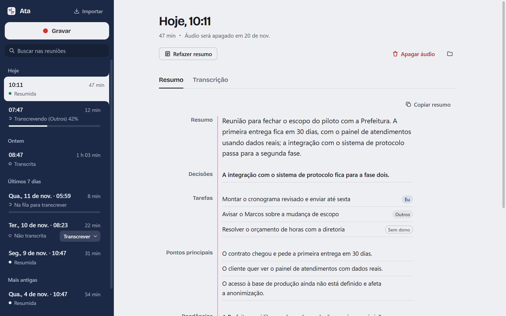
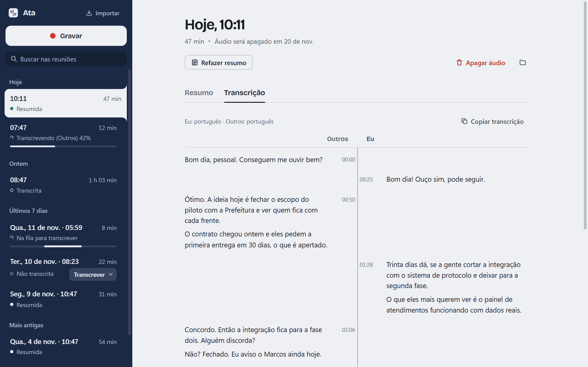
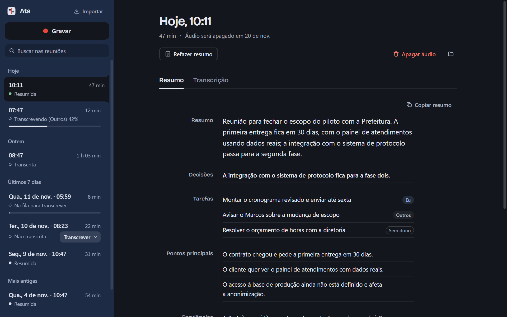

# Ata

App desktop que grava reuniões e ligações no computador, transcreve e gera um resumo com
decisões e tarefas. **Tudo roda na sua máquina:** o áudio, a transcrição e o resumo nunca
saem do computador, e não há API paga nem conta para criar.



## O que ele faz

- **Grava o microfone e o áudio do sistema em canais separados.** O que sai das caixas de
  som é "Outros", o que entra no microfone é "Eu". Assim a transcrição sabe quem falou sem
  precisar de diarização.
- **Importa arquivos** de áudio ou vídeo (mp3, m4a, wav, mp4, áudio do WhatsApp), pelo botão
  ou arrastando para a janela.
- **Transcreve localmente** com [whisper.cpp](https://github.com/ggml-org/whisper.cpp)
  (modelo `large-v3-turbo`), na GPU NVIDIA quando houver e na CPU quando não.
- **Resume com um modelo local** no [Ollama](https://ollama.com) (`qwen3.5:4b`): visão geral,
  decisões, tarefas com responsável, pontos principais e pendências. Conversas longas são
  resumidas em partes e depois juntadas.
- **Responde perguntas sobre uma reunião** ("o que ficou combinado sobre o prazo?"), citando
  os horários da transcrição.
- **Busca em todas as reuniões**, sem diferenciar acentos nem maiúsculas.
- **Apaga o áudio sozinho depois de 7 dias.** A transcrição e o resumo ficam; o áudio, que é o
  dado mais sensível e mais pesado, não.
- Tudo entra numa **fila em segundo plano**: a gravação termina e a transcrição começa; a
  transcrição termina e o resumo começa, com o progresso visível na lista.

| Transcrição                                                                          | Tema escuro                                             |
| ------------------------------------------------------------------------------------ | ------------------------------------------------------- |
|  |  |

## Como funciona

```
gravação: microfone (mic.webm) + áudio do sistema por loopback (system.webm)
  → ffmpeg → whisper.cpp, um canal por vez, com detector de voz (Silero VAD)
  → trechos com horário e falante, ordenados no tempo → transcript.json
  → Ollama, em partes de até ~24 mil caracteres, com saída em JSON validada → summary.json
```

- **Electron + React + TypeScript.** O loopback do Windows vem do próprio Chromium
  (`getDisplayMedia` com `audio: 'loopback'`), sem código nativo.
- **Uma fila única de tarefas** no processo principal (`src/main/jobs.ts`): Whisper e Ollama
  rodam um depois do outro para caber em 16 GB de RAM.
- **Armazenamento em arquivos JSON**, uma pasta por gravação em `%APPDATA%\ata\recordings`.
- **Perguntas sobre a reunião** (`src/main/ask.ts`): como a transcrição inteira não cabe no
  contexto do modelo pequeno, os trechos são escolhidos por relevância das palavras da
  pergunta (uma espécie de TF-IDF com radical simples), mais trechos espalhados para
  perguntas vagas.

As decisões de projeto e as alternativas descartadas estão em [docs/mvp.md](docs/mvp.md);
a identidade visual, em [docs/design.md](docs/design.md).

## Desempenho

Medido num notebook com i7-11390H, 16 GB de RAM e GPU NVIDIA MX450 de 2 GB
(detalhes em [docs/benchmark.md](docs/benchmark.md)):

| Etapa                            | 1 h de reunião |
| -------------------------------- | -------------- |
| Transcrição na GPU (modo guloso) | ~10 min        |
| Transcrição só na CPU            | ~1 h 40        |
| Resumo com `qwen3.5:4b`          | ~9 min         |

Três ajustes fizeram a diferença: o modo guloso (`-bs 1 -bo 1`) é ~15× mais rápido que o
beam search padrão sem perder qualidade; o detector de voz (`--vad`) acabou com as frases
que o Whisper inventava nos silêncios; e a detecção automática de idioma (`-l auto`)
corrigiu áudio em inglês que virava texto sem sentido com o idioma fixo em português.

## Instalação

Requisitos: Windows 10 ou 11, [Node.js](https://nodejs.org) 22 ou mais novo e cerca de 8 GB
livres para as ferramentas e os modelos. GPU NVIDIA é opcional.

```bash
git clone https://github.com/vitorazevedop7/ata.git
```

```bash
cd ata
```

```bash
npm install
```

```bash
npm run setup:tools
```

O `setup:tools` baixa ffmpeg, whisper.cpp (CPU e, se houver GPU NVIDIA, CUDA), Ollama e os
modelos para `%LOCALAPPDATA%\Programs` e `%LOCALAPPDATA%\ata\models`. Se você já tem
alguma dessas ferramentas, aponte o app para ela com as variáveis `ATA_FFMPEG`,
`ATA_WHISPER_CLI`, `ATA_MODELS_DIR`, `ATA_OLLAMA` e `ATA_OLLAMA_MODEL`.

```bash
npm run dev
```

Para gerar o instalador: `npm run build:win` (sai em `dist/`).

## Desenvolvimento

| Comando             | O que faz                                              |
| ------------------- | ------------------------------------------------------ |
| `npm run dev`       | Abre o app com recarga automática                      |
| `npm test`          | Testes unitários (Vitest)                              |
| `npm run typecheck` | Checagem de tipos do processo principal e da interface |
| `npm run lint`      | ESLint + Prettier                                      |
| `npm run build:win` | Instalador para Windows                                |

```
src/main       processo principal: captura, fila, transcrição, resumo, perguntas, busca, retenção
src/preload    ponte window.api entre a interface e o processo principal
src/renderer   interface em React
src/shared     tipos usados pelos três
bench          scripts usados para medir Whisper e Ollama
```

## Privacidade e consentimento

O Ata não envia nada para a internet: a transcrição e o resumo rodam em processos locais
(whisper.cpp e Ollama em `127.0.0.1`). Mesmo assim, gravar uma conversa é com você:
**avise os participantes antes de gravar**, como pede a LGPD.

## Limitações conhecidas

- Só Windows, por enquanto (a captura do áudio do sistema usa o loopback do Windows).
- Sem fone de ouvido, o microfone também capta a voz dos outros saindo pelas caixas de som,
  e ela aparece nos dois canais.
- Não separa mais de dois falantes: "Outros" é todo mundo do outro lado da chamada.
- Não transcreve ao vivo; o processamento começa quando a gravação termina.

## Licença

[MIT](LICENSE)
